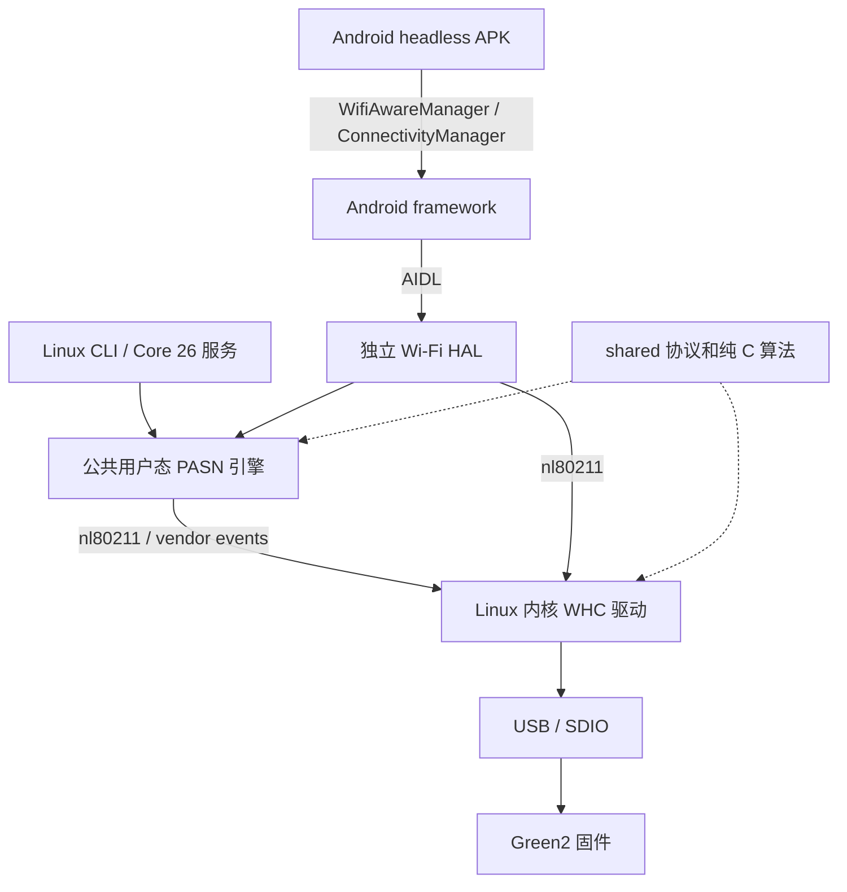

# Architecture

五层分工如下：

| 目录 | 职责 | 当前实现边界 |
| --- | --- | --- |
| shared | 固定宽度协议结构、宏、纯 C NIRA 解析和缓存差分 | 无 Binder、hostap、Netlink、文件或线程依赖 |
| driver | 内核模块、WHC 收发、USB/SDIO 绑定和 cfg80211 接入 | Linux / Android 共享；现有 core 仍使用 Linux 内核 API |
| cli_tool | 用户态 CLI、PASN 引擎、Linux 发布服务和 Core 26 镜像集成 | CMake；依赖匹配的 hostap、OpenSSL 与 libnl |
| android_app | Gradle/NDK APK、独立 AIDL HAL、Android 镜像打包 | 包名 cn.zenghome.flashstudio；HAL 与 APK 分别构建/部署 |
| docs | 架构、构建、调试、验证说明 | 记录已测范围及未实现项目 |

当前是 FullMAC/cfg80211 驱动，没有把它改造成 mac80211 SoftMAC 驱动。
Windows 目录记录 WiFiCx/NetAdapterCx 接入边界；尚无 Windows 驱动，Linux
core 中的 skb、锁、线程与 cfg80211 调用也尚未抽象为可直接用于 Windows 的 OS API。
不能把目录重排等同于已完成 Windows 移植。

APK 的 NDK 层承载 TCP/SRT 与 JNI。Green2 USB 接口由内核驱动管理，APK
通过 Android 网络服务使用 Wi-Fi Aware，因此本实现不引入 UsbManager 授权界面
或 libusb 并行接管。未来独立 raw-USB 后端需要另行设计设备所有权与协议适配。

PASN 引擎留在用户态：它包含 hostap/密码学、Netlink 和存储适配，不能放入
纯 C 的 shared 或内核代码。只把无 OS 依赖的 wire record、属性解析与缓存
差分移入 shared。NIK/NPK 文件路径和日志/存储回调由 HAL 或 CLI 提供。

Android 必须在握手、密钥安装和本次 NIK 交换完成后向 framework 确认配对；
数据链路建立/结束时配置和清理 IPv6 邻居；TCP 在服务发布前绑定 NAN 地址，
避免 iPhone 的首个 SYN 早于应用网络回调。配对密钥保留在平台私有存储中。
